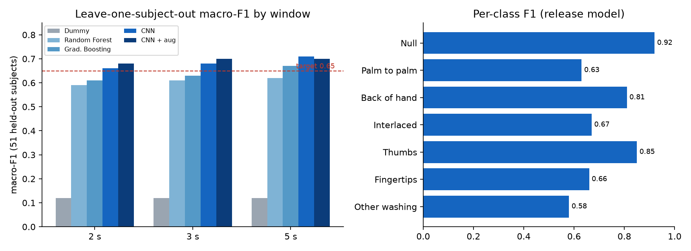

<p align="center">
  
</p>

<h1 align="center">HapticWash-AI</h1>

<p align="center">
  <strong>The model behind HapticWash.</strong><br>
  A tiny 1D CNN that recognises the WHO hand-rubbing steps from a smartwatch's motion sensors, trained and evaluated on people it has never seen.
</p>

<p align="center">
  
  
  
  
  
  
</p>

> **This is the AI repo** (Python, never runs on the watch). The Wear OS app lives in the
> separate [**HapticWash**](../HapticWash%20-%20Main/README.md) repo and consumes this repo's release
> artifacts (`model.tflite` + `model_meta.json` + `golden/*.npy`).

---

## The model

| | |
|---|---|
| **Task** | Classify a 3-second window of wrist motion into 7 classes: `NULL`, `PALM_TO_PALM`, `BACK_OF_HAND`, `INTERLACED_FINGERS`, `THUMBS`, `FINGERTIPS`, `WASH_OTHER` |
| **Input** | `float32[1, 150, 6]`: 3 s at 50 Hz, channels `ax ay az gx gy gz` (accelerometer + gyroscope) |
| **Output** | `float32[1, 7]` softmax. The app smooths it causally over 3 s |
| **Architecture** | 1D CNN: 3 × (Conv1D → BatchNorm → ReLU → MaxPool) with 32/64/64 filters, global average pooling, dropout 0.3, dense softmax |
| **Size** | 37,992 bytes after int8 quantisation (budget 150 KB) |
| **Release** | `step-classifier` v0.1.0 |

Small on purpose: it runs on a watch, offline, in real time, with a size and latency budget set by the app.

## How it was trained

**Data.** Public handwashing IMU datasets, each converted to one canonical schema by its own ingest adapter (resampled to 50 Hz, mapped to the Android sensor frame, with explicit source-label → canonical-label tables in [`docs/label_mapping.md`](docs/label_mapping.md)):

| Dataset | Role | Licence |
|---|---|---|
| **UWash**: 51 subjects, Samsung Gear Sport, 50 Hz | **Training** (release model uses 50 subjects) | MIT |
| **zhang_who**: 10 subjects, Byteflies, 100 Hz | **External test only**, never used for training or model selection | CC BY-NC-ND 4.0 |
| Ablutomania | Hard negatives / confounders | CC BY-4.0 |
| OCDetect | All-day background (future work: wash spotting) | CC BY-4.0 |

Datasets are never committed or redistributed. [`docs/DATASETS.md`](docs/DATASETS.md) has licences and citations.

**Preprocessing** (mirrored exactly in the app and checked by a golden-file parity test):
resample with an anti-aliased polyphase filter → unit normalisation → gravity alignment → causal Butterworth band-pass (1–18 Hz, order 3) → per-channel z-score. Windows are 3 s with 50 % overlap.

**Training.** Keras, Adam (lr 0.002), batch size 256, 30 epochs, inverse-frequency class weights, fixed seed with op determinism. No early stopping, because the only held-out data is the test subject. Augmentation is redrawn every epoch: rotation ±15°, amplitude × U(0.5, 1.5), jitter 0.05·std.

**Evaluation.** Leave-one-subject-out cross-validation: 51 folds, each testing on one person the model never trained on. Metrics are reported per subject as mean ± std, never a single pooled accuracy. Subject-disjointness is asserted in code, with a test that deliberately leaks a subject and checks the guard fires. Every headline number sits beside a dummy-classifier baseline.

**Export.** int8 quantisation to LiteRT, plus `model_meta.json` (labels, preprocessing constants, tensor shapes) and golden input/output files the app uses for parity tests.

## Results

<p align="center">
  
</p>

| | macro-F1 (LOSO, 51 subjects) | chance |
|---|---|---|
| **Release: 1D CNN + augmentation, 3 s window, 3 s smoothing** | **0.705 ± 0.127** (median 0.73, min 0.44, max 0.96) | 0.10 |

- Target (≥ 0.65) met. Stretch (≥ 0.75) not met.
- A 1D CNN beats Random Forest and Gradient Boosting on hand-built features at every window size.
- Post-quantisation macro-F1 drop is 0.000 (limit 0.02). TFLite agrees with the float model on 100 % of 298 golden windows.
- Weakest classes are the ones that look alike on the wrist: interlaced fingers ↔ back of hand, palm ↔ fingertips.

**Known limits, stated plainly.** On the external `zhang_who` set (different sensor and protocol) the model scores 0.56 on the left wrist and 0.44 on the right, so cross-device generalisation is the main risk. Training data is left-wrist only; right-wrist wearers are mirrored. Only an on-watch test measures the real target domain. Full numbers, sweeps and confusion analysis: [`reports/M2_step_classifier.md`](reports/M2_step_classifier.md). Design choices are logged in [`docs/DECISIONS.md`](docs/DECISIONS.md).

## Setup

Requires [`uv`](https://docs.astral.sh/uv/) and Python 3.11 (uv fetches it).

```sh
uv sync                 # core: schema, ingest, preprocess, evaluate
uv sync --all-extras    # + TensorFlow (Linux only; needed for training and export)
```

```sh
uv run pytest                                      # tests
uv run ruff check . && uv run ruff format --check .  # lint
python scripts/fetch_data.py                       # download datasets into data/
uv run python -m haptic_ai.cli ingest --all        # build the canonical corpus
uv run python -m haptic_ai.cli report-corpus       # per-dataset corpus report
uv run --extra ml python -m haptic_ai.cli evaluate --config configs/step_cnn.yaml  # LOSO sweep (Linux/WSL)
uv run --extra ml python -m haptic_ai.cli export   --config configs/step_cnn.yaml  # LiteRT + model_meta.json + golden (Linux/WSL)
```

## Repository layout

```
haptic_ai/
├── ingest/        one adapter per source dataset
├── schema.py      canonical schema + validators
├── preprocess.py  resample, align, filter, mirror, augment
├── features.py    hand-crafted features for the tree baselines
├── windows.py     windowing + label assignment
├── models/        cnn1d.py, tree.py
├── evaluate.py    LOSO CV, metrics, confusion matrices
└── export.py      quantise → tflite + model_meta.json
configs/           one YAML per experiment
reports/           committed metric JSON + figures
docs/              specs, decisions, datasets, label mapping
```

## Datasets and citations

- **UWash**: Wang, F. et al. (2025). *You Can Wash Hands Better: Accurate Daily Handwashing Assessment with a Smartwatch.* IEEE TMC. arXiv:2112.06657. https://github.com/aiotgroup/UWash
- **zhang_who**: Zhang, Y. (2022). *Replication Data for: handwashing steps with IMU signals* (V1.0). KU Leuven RDR. https://doi.org/10.48804/XHPPC7
- **Ablutomania**: Scholl, P. & Wahl, F. (2021). Ablutomania-Set.
- **OCDetect**: Zenodo record 13924901.

## Licence

Code: [MIT](LICENSE). The shipped weights carry the lineage of the training data above; `zhang_who` is non-commercial and is used for evaluation only. HapticWash is a non-commercial portfolio project. See [`docs/DECISIONS.md`](docs/DECISIONS.md) (D4, D15).
